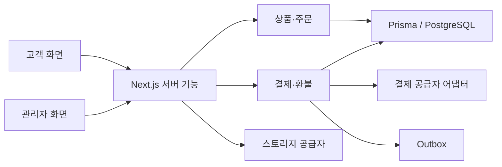

# Mira

가발 상품 탐색과 주문을 연결하는 커머스 플랫폼 팀 프로젝트입니다. Next.js 기반 고객·관리자 화면과 함께 상품, 주문, 결제, 환불, 파일 저장을 다루는 서버 기능을 개발하고 있습니다.

**팀 프로젝트 · 주요 담당: 서비스 기획 및 백엔드 개발**

아래 기능과 구조는 팀 저장소 전체를 설명합니다. 프런트엔드와 모든 모듈을 단독 구현했다는 의미는 아닙니다.

## 먼저 살펴볼 코드

| 주제 | 구현과 확인 경로 |
| --- | --- |
| 결제 결과에서 주문 확정까지 | [완료 진입점](src/lib/payment/complete/index.ts) · [트랜잭션](src/lib/payment/complete/transaction.ts) · [통합 테스트](src/lib/payment/complete/__tests__/complete.integration.test.ts) |
| 결제 수단 선택과 운영 모드 | [공급자 라우팅](src/lib/payment/providers/routing.ts) · [SANDBOX/LIVE 설정](src/lib/payment/mode.ts) |
| 환불 작업의 동시 실행 제어 | [실행 lease 획득](src/lib/payment/refund/acquire-lease.ts) · [통합 테스트](src/lib/payment/refund/__tests__/acquire-lease.integration.test.ts) |
| 후속 작업 기록과 중복 처리 | [Outbox 기록](src/lib/payment/outbox/enqueue.ts) · [통합 테스트](src/lib/payment/outbox/__tests__/outbox.integration.test.ts) |
| 주문 데이터와 스키마 | [주문 스냅샷](src/lib/order/snapshot.ts) · [Prisma 스키마](prisma/schema.prisma) · [마이그레이션](prisma/migrations) |

## 기술 구성

| 영역 | 구성 |
| --- | --- |
| 웹·서버 | Next.js 16, React 19, TypeScript, Node.js 24 |
| 데이터 | PostgreSQL 18 기준 CI, Prisma 7 |
| 인증 | NextAuth, Prisma Adapter |
| 파일 저장 | 공급자 추상화, AWS S3 SDK, 로컬 개발용 mock |
| 결제 | 공급자별 어댑터, SANDBOX/LIVE 구분, 활성화 조건 |
| 검증 | Vitest, TypeScript 검사, ESLint, GitHub Actions |

정확한 의존성은 [package.json](package.json)과 [package-lock.json](package-lock.json), Node 버전은 [.nvmrc](.nvmrc)를 따릅니다.

## 시스템 구조



어댑터 구현, 테스트, 외부 서비스 활성화는 각각 구분합니다. 저장소에 결제 코드가 있다는 사실만으로 실결제 운영이나 매출 실적을 의미하지 않습니다.

## 백엔드 구현 포인트

### 1. 결제 확인과 주문 확정의 일관성

[결제 완료 흐름](src/lib/payment/complete/index.ts)은 결제 사실 기록과 주문 확정 처리를 연결합니다. [완료 트랜잭션](src/lib/payment/complete/transaction.ts)은 체크아웃 세션을 잠그고 현재 결제·금액·통화·주문 항목을 확인한 뒤 주문 생성, 재고 반영, 세션 완료, 후속 알림 의도 기록을 수행합니다.

동일 결제로 이미 완료된 세션은 기존 완료 결과를 반환하는 분기가 있습니다. 관련 실패·재진입 조건은 [통합 테스트](src/lib/payment/complete/__tests__/complete.integration.test.ts)에서 살펴볼 수 있습니다.

### 2. 환불 실행 권한과 동시성

[환불 lease 획득](src/lib/payment/refund/acquire-lease.ts)은 주문·환불 시도·실행 명령을 잠그고 현재 상태를 확인한 뒤 세대 번호와 토큰 해시, 만료 시각을 기록합니다. 조건부 갱신과 이벤트 기록을 같은 트랜잭션에서 처리합니다.

lease 획득 자체가 외부 환불 호출은 아닙니다. 실행 권한, 작업 선택, 공급자 호출, 결과 반영은 별도 단계와 활성화 조건을 갖습니다.

### 3. 트랜잭션 안에서 후속 작업 기록

주문 완료 시 알림 의도를 기록하고, [Outbox](src/lib/payment/outbox/enqueue.ts)에 중복 키를 둔 작업을 저장하는 구조입니다. 주문 상태 변경과 후속 작업 기록의 관계, 중복 요청 처리를 코드와 [테스트](src/lib/payment/outbox/__tests__/outbox.integration.test.ts)로 확인할 수 있습니다.

### 4. 결제 공급자와 운영 환경 분리

[라우팅 설정](src/lib/payment/providers/routing.ts)은 마켓·결제 방법·통화·모드에 따라 공급자를 선택합니다. 현재 LIVE 허용 목록은 비어 있고 EXIMBAY는 SANDBOX 범위로 정의되어 있습니다. SANDBOX 설정만으로 모든 외부 호출이 켜지는 것은 아니며 공급자별 자격 증명과 활성화 조건이 따로 있습니다.

## 로컬 개발

### 사전 준비

- Node.js 24와 npm
- 개발 전용 PostgreSQL 18 데이터베이스
- [.env.example](.env.example)을 바탕으로 한 로컬 `.env`
- 테스트를 실행할 경우 개발 DB와 구분된 테스트 DB 및 [.env.test.example](.env.test.example)을 바탕으로 한 `.env.test`

`DATABASE_URL`은 로컬 개발 DB를 가리키도록 설정하고 `NEXTAUTH_SECRET`을 생성합니다. `NEXTAUTH_URL`의 로컬 기본값은 `http://localhost:3000`입니다. 초기 확인은 예시의 `AI_PROVIDER=mock`, `STORAGE_PROVIDER=mock`과 비활성화된 외부 연동 설정을 사용합니다.

### 설치와 실행

저장소 루트에서 실행합니다. 아래 마이그레이션 명령은 지정된 DB에 스키마를 반영하므로 먼저 `DATABASE_URL`의 대상을 확인합니다.

```bash
npm ci
npx prisma generate
npx prisma migrate deploy
npm run dev
```

브라우저에서 `http://localhost:3000`에 접속합니다. 빈 개발 DB에서는 상품과 계정 데이터가 없으므로 모든 사용자 흐름을 바로 시연할 수 있는 것은 아닙니다.

기본 실행 절차에는 seed를 포함하지 않습니다. 현재 [seed](prisma/seed.ts)는 데모 데이터 교체를 위한 별도 확인 조건이 있는 작업입니다. 관리자 권한, 상품 데이터, 결제·환불 기능 활성화도 해당 기능의 설정과 운영 절차를 따릅니다.

## 검증

```bash
npm run typecheck
npm run lint
```

전체 검증은 `npm run verify`이며 TypeScript 검사, lint, Vitest를 순서대로 수행합니다. DB 테스트 전에 테스트 전용 데이터베이스에 마이그레이션을 적용해야 합니다.

```bash
# .env.test의 DATABASE_URL이 테스트 전용 DB인지 먼저 확인
node --env-file=.env.test node_modules/prisma/build/index.js migrate deploy
# 기존 셸의 DB 값을 제거하고 .env.test를 사용하는 전체 검증 (macOS/Linux)
env -u DATABASE_URL npm run verify
```

[테스트 초기화 코드](src/__tests__/setup.ts)는 이미 설정된 `DATABASE_URL`을 우선 사용하므로 개발·운영 DB 값이 남아 있지 않은지 확인해야 합니다.

[Vitest 설정](vitest.config.ts)은 DB 테스트를 직렬로 실행합니다. [CI](.github/workflows/ci.yml)는 별도 PostgreSQL 18 클러스터에 마이그레이션을 적용하고 전체 검증을 실행하도록 구성되어 있습니다.

## 기능 상태와 문서

- 상품·주문·결제·환불은 구현과 테스트를 읽을 수 있는 영역입니다. 현재 배포·사용 가능 여부는 기능별 설정 및 최신 운영 기록을 확인해야 합니다.
- 피팅·스토리지는 공급자 추상화와 mock 경로가 있습니다. mock 결과를 실제 AI 피팅 정확도나 외부 저장 성공으로 해석하지 않습니다.
- Render Lab은 내부 렌더링 실험 영역입니다. 커머스·제조 기능의 완성을 의미하지 않습니다.
- 이 문서 정리 과정에서 앱 시연, 실결제, 전체 테스트 통과 또는 성능 수치를 새로 검증하지 않았습니다.

더 자세한 맥락은 [제품 문서](docs/product/README.md), [상품 탐색 문서](docs/discovery/README.md), [기술 문서](docs/engineering/README.md), [운영 문서](docs/operations/README.md)에서 확인할 수 있습니다.

문서 정리: 2026-11-13. 실제 개발 이력은 기존 커밋과 PR에 보존합니다.
