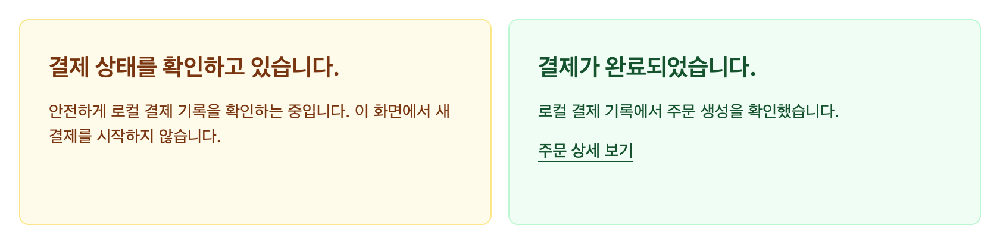
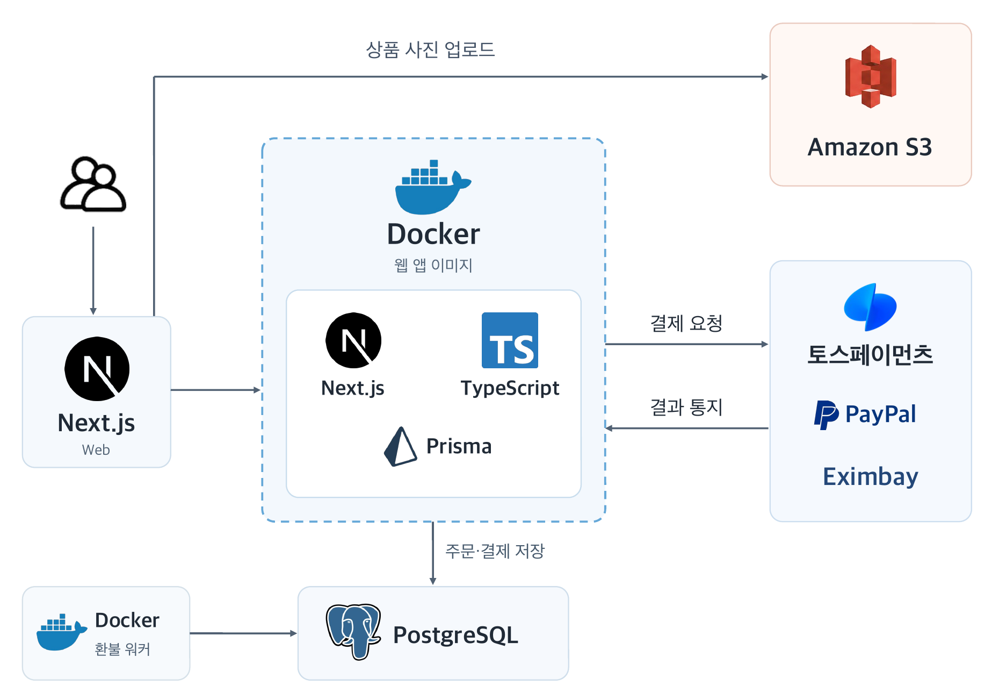
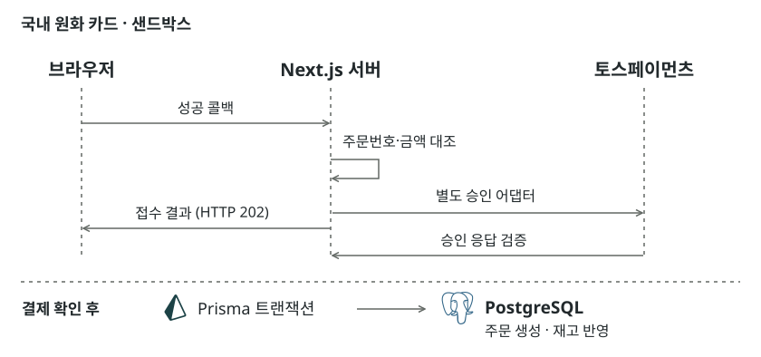
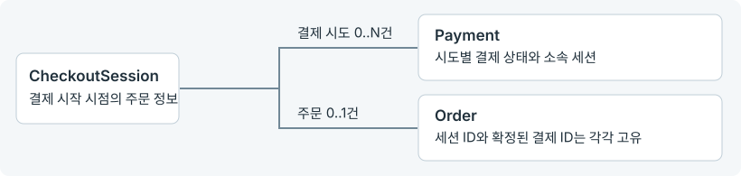

# Mira

Mira는 가발의 스타일과 색상, 길이를 골라 주문하는 쇼핑몰로, 팀 프로젝트로 개발했습니다. 한국·미국·일본 고객이 같은 주문 화면에서 각 시장에 맞는 결제 수단을 쓸 수 있도록 기획했습니다. 기본 샌드박스 설정에서는 모의 결제 응답을 사용합니다.

## 결제 결과 화면

서버는 결제 시작 시점의 상품, 수량, 금액을 체크아웃 세션에 기록합니다. 고객이 결제창에서 돌아오면 결과 화면은 서버에서 주문 상태를 조회하고, 주문이 확정된 뒤 상세 페이지 링크를 표시합니다.

테스트 데이터로 표시한 주문 확인 중 화면(왼쪽)과 완료 화면(오른쪽)입니다. [체크아웃 세션 생성](src/lib/payment/session/create.ts) · [결제 결과 화면](src/app/(shop)/checkout/return/[checkoutSessionId]/PaymentReturnStatus.tsx)

## 전체 아키텍처

고객 화면과 관리자 화면은 하나의 Next.js 앱에 있습니다. 상품 사진을 등록할 때 서버는 서명 URL을 발급하고, 관리자 브라우저는 그 주소로 사진을 S3에 직접 업로드합니다. 서버는 Prisma로 PostgreSQL에 주문과 결제 상태를 저장합니다. [DB 연결](src/lib/db.ts) · [사진 업로드 URL 발급](src/app/actions/admin/catalog.ts)

환불 워커는 별도 Docker 이미지로 빌드합니다. 샌드박스 통합 브랜치에서는 웹 앱 이미지도 빌드해 Google Artifact Registry에 등록하고 검증했습니다. [환불 워커 구성](containers/refund-worker/README.md) · [웹 앱 이미지 검증 기록](https://github.com/DuckCow/mira-wig/blob/1b95c78d24e3b081c359a9242d327553e0512bb8/containers/mira-application/artifact-v1.json)

## 결제 요청과 결과 통지

서버는 국가, 통화, 결제 수단을 기준으로 결제사를 선택합니다. 국내 원화 카드는 토스페이먼츠, 미국 달러 카드는 Eximbay, 미국과 일본의 PayPal 지갑 결제는 PayPal로 연결하도록 구성했습니다. [결제 연동 설정](src/lib/payment/providers/factory.ts) · [결제사 선택 규칙](src/lib/payment/providers/routing.ts) · [PayPal 웹훅](src/app/api/payments/paypal/webhook/route.ts) · [Eximbay 상태 통지](src/app/api/payments/eximbay/status/route.ts)

토스 성공 콜백에서는 주문번호와 금액을 대조한 뒤 처음 접수한 정상 요청에 HTTP 202를 반환합니다. 결제 승인은 별도 어댑터가 담당합니다. 샌드박스 웹훅 검증을 활성화한 경우에는 통지에 포함된 결제 키로 토스에 결제 상태를 조회합니다. [성공 콜백](src/app/api/payments/toss/success/route.ts) · [승인 어댑터](src/lib/payment/providers/toss/adapter.ts) · [웹훅 검증 설정](src/lib/payment/webhook/pipeline.ts)

## 주문 확정과 중복 주문 방지

서버는 체크아웃 세션을 잠근 뒤 같은 결제로 생성한 주문이 있는지 확인합니다. 기존 주문이 있으면 해당 주문 ID를 반환합니다. 새 주문은 재고 상품의 수량 차감, 장바구니 갱신과 함께 한 트랜잭션에서 확정합니다. 주문 테이블에는 세션 ID와 결제 ID에 각각 고유 제약을 두었습니다. [주문 확정 트랜잭션](src/lib/payment/complete/transaction.ts) · [데이터 모델](prisma/schema.prisma)

결제 도중 장바구니에 더 담은 상품은 주문이 끝난 뒤에도 남아야 합니다. 이를 위해 세션에 장바구니 항목과 구매 수량을 기록하고, 주문을 확정할 때 결제를 시작한 수량만 차감합니다. [세션 생성](src/lib/payment/session/create.ts)

Vitest 통합 테스트로 주문 확정 후 DB에 남은 값을 확인했습니다.

| 테스트 조건 | 확인한 결과 |
| --- | --- |
| 같은 결제 정보로 주문 확정 함수를 동시에 두 번 호출 | 주문 1건만 생성됩니다. 뒤이어 처리된 호출은 같은 주문 ID를 반환합니다. |
| 1개를 결제하는 동안 같은 상품 2개를 장바구니에 추가 | 결제한 1개만 차감되고 추가한 2개는 남습니다. |
| 결제 시작 시 1개였던 재고가 주문 확정 직전에 소진 | 주문은 생성되지 않고 장바구니 항목은 남습니다. 후속 처리 작업 1건이 기록됩니다. |

[주문 확정 테스트 50개 통과 기록](https://github.com/DuckCow/mira-wig/actions/runs/43392270238) · [테스트 코드](src/lib/payment/complete/__tests__/complete.integration.test.ts)
